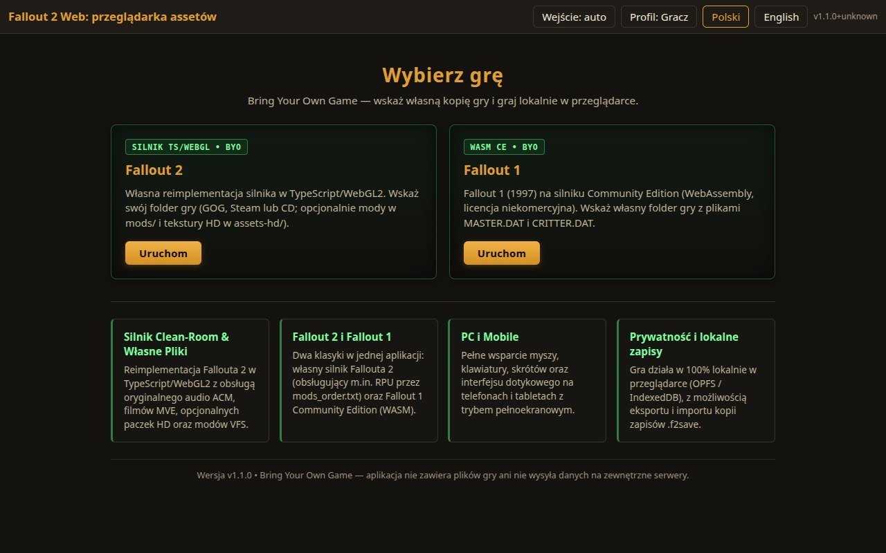
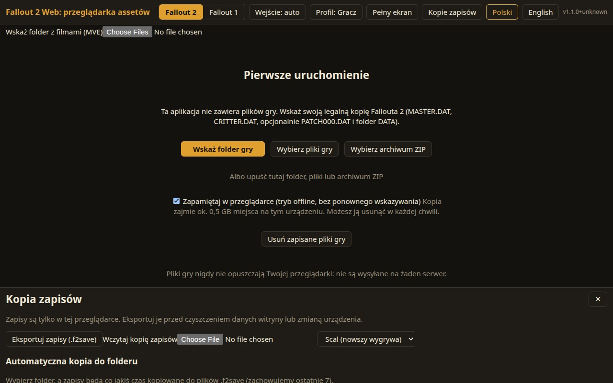
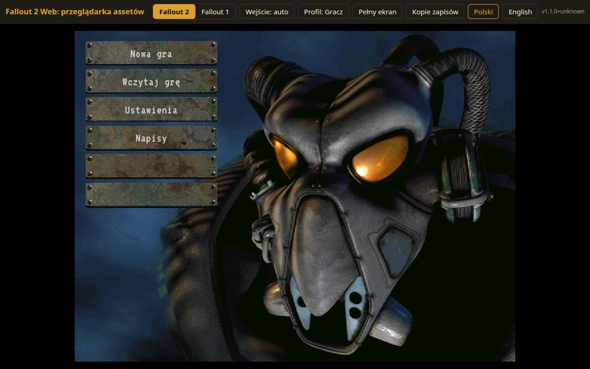
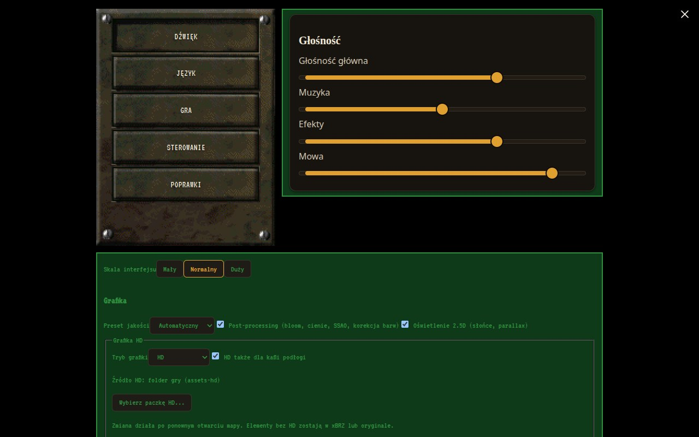
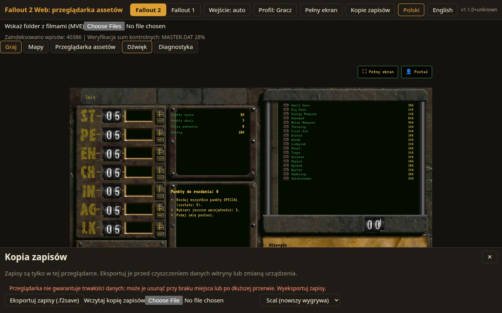
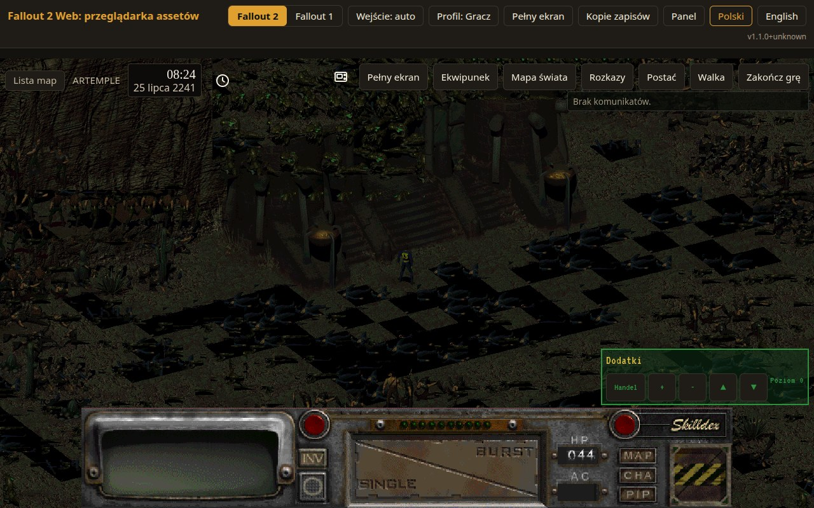
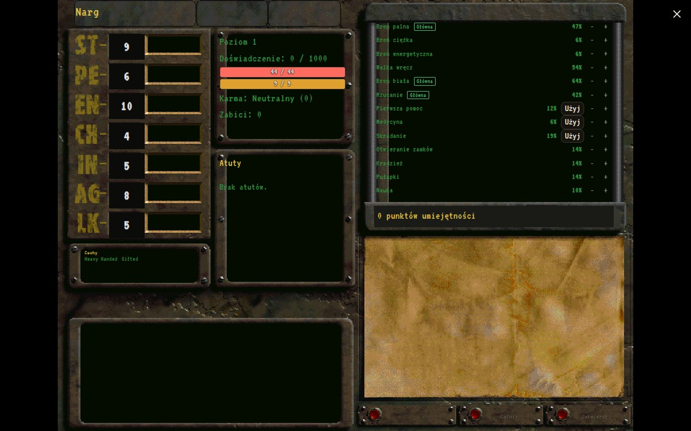
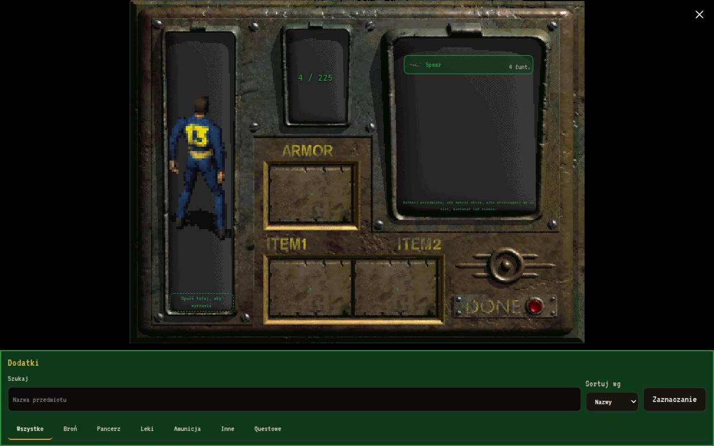
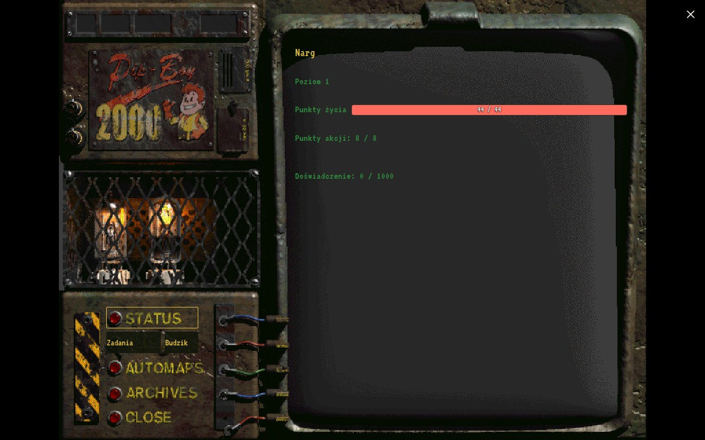
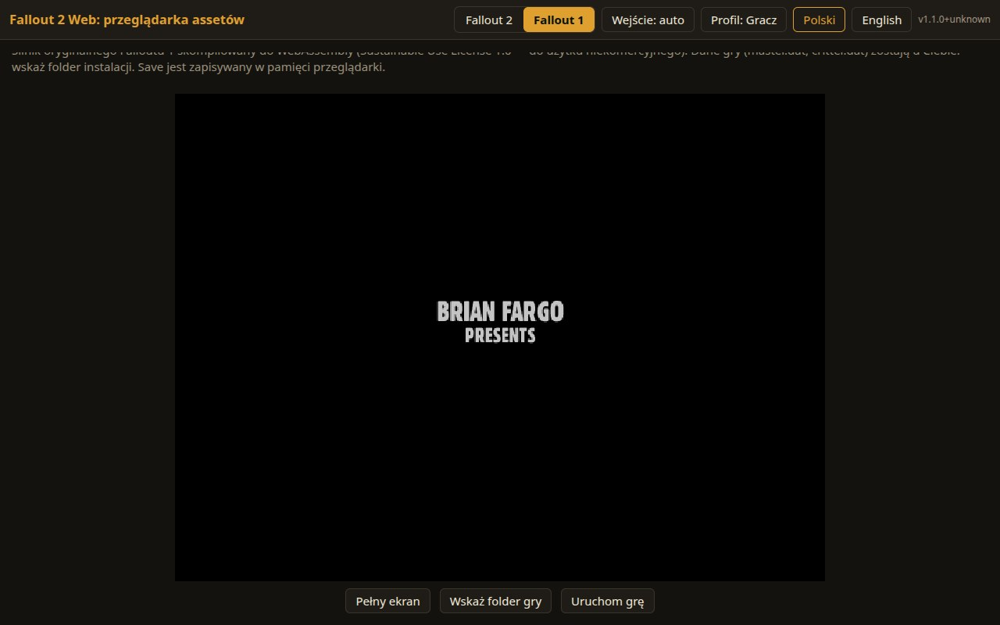

# Fallout 2 & Fallout 1 Web — Bring Your Own Game (v1.1.0)

**[English](README.en.md)** | **[Polski](README.md)**

Browser edition of **Fallout 2** (custom **TypeScript + WebGL2** engine) and **Fallout 1** (embedded **Community Edition** compiled to **WebAssembly**), running 100% locally in **Bring Your Own Game (BYO)** mode.

This application **contains no copyrighted game files** (no artwork, audio, movies, scripts, or game text). To play, you select your own legal game folder, files, or `.zip` archive (from GOG, Steam, or CD) directly in your browser. All files are processed strictly locally in browser storage (OPFS / IndexedDB) and are never uploaded anywhere.

---

## Table of Contents

1. [Screenshots](#screenshots)
2. [Legal & Licensing](#legal--licensing)
3. [Requirements](#requirements)
4. [Detailed Local Setup & Build Guide](#detailed-local-setup--build-guide)
5. [Static Production Hosting (Nginx, Caddy, Cloudflare / Netlify / GitHub Pages)](#static-production-hosting)
6. [How to Load Your Own Game (Fallout 2 & Fallout 1)](#how-to-load-your-own-game-fallout-2--fallout-1)
7. [HD Textures (`hd-pack/assets-hd/`) & 2.5D Effects](#hd-textures-hd-packassets-hd--25d-effects)
8. [Mods (Fallout 2 VFS)](#mods-fallout-2-vfs)
9. [Controls (Desktop & Mobile/Touch)](#controls-desktop--mobiletouch)
10. [Profiles, Saves & Cross-Device Backups](#profiles-saves--cross-device-backups)
11. [Security, CSP & Privacy](#security-csp--privacy)
12. [Troubleshooting & Documentation](#troubleshooting--documentation)

---

## Screenshots

### Home — Game Selection (Fallout 2 / Fallout 1)


### Fallout 2 — Bring Your Own Game (Folder / File / ZIP Picker)


### Fallout 2 — Main Menu & HD / 2.5D Graphics Options
| Main Menu | Options (HD, 2.5D Lighting, Fixes) |
|---|---|
|  |  |

### Fallout 2 — Character Creator & In-Game Map (HD + 2.5D)
| Character Creator | Game Map (HD + 2.5D Lighting) |
|---|---|
|  |  |

### Fallout 2 — Character Sheet, Inventory & Pip-Boy 2000
| Character Sheet | Inventory | Pip-Boy 2000 |
|---|---|---|
|  |  |  |

### Fallout 1 — Community Edition (WebAssembly)


---

## Legal & Licensing

- **Application & Fallout 2 Engine (TypeScript/WebGL2):** licensed under the **[MIT License](LICENSE)**.
- **No game files in app or build output:** `.dat`, `.frm`, `.acm`, `.mve`, `.pro`, `.map`, `.int`, `.msg`, `.exe` files are blocked by `.gitignore` and [`scripts/guard-no-game-files.mjs`](scripts/guard-no-game-files.mjs). The production bundle `apps/web/dist/` contains zero game assets and zero HD packs.
- **Optional HD Pack (`hd-pack/assets-hd/`):** stored separately alongside the app for personal use with your own legal copy of Fallout 2 (not part of the MIT engine code or `apps/web/dist/`).
- **Fallout 1 Community Edition (WASM):** `apps/web/public/engines/fo1-ce/` and `tools/fo1-ce-patches/` contain an Emscripten port based on `alexbatalov/fallout1-ce` and `K1ngst0m/fallout1-ce-web` under the **[Sustainable Use License 1.0](licenses/SUSTAINABLE-USE-LICENSE-1.0.txt)** — **personal / non-commercial use only** (see [THIRD_PARTY_NOTICES.md](THIRD_PARTY_NOTICES.md)).
- **VT323 Font:** **SIL Open Font License 1.1**.
- **Trademarks:** *Fallout* and *Fallout 2* are trademarks of Bethesda Softworks LLC / ZeniMax Media Inc. This is an independent hobbyist reimplementation.

---

## Requirements

### Browser (to play)
A modern browser supporting **WebGL2** and **WebAssembly**:
- **Chrome / Edge (Desktop & Android):** full support for direct folder access (File System Access API) and persistent OPFS storage.
- **Safari / iOS (15.4+, 16.4+ recommended):** folder selection via `webkitdirectory` or `.zip` archive; files are copied into OPFS (requires ~0.6–2 GB of free storage depending on mods).
- **Firefox:** folder / file / `.zip` selection and OPFS storage.

### Development Environment (to build from source)
- **Node.js `>= 24`**
- **pnpm `12.x`** (`corepack enable` or `npm i -g pnpm@12`)

---

## Detailed Local Setup & Build Guide

1. **Clone the repository and install dependencies:**
   ```sh
   git clone https://github.com/cenkierpiotr/fallout2-web-byo.git
   cd fallout2-web-byo
   pnpm install
   ```

2. **Start the development server:**
   ```sh
   pnpm dev
   ```
   Open `http://localhost:5173` in your browser.

3. **Testing on a phone over LAN (optional):**
   ```sh
   pnpm dev -- --host
   ```
   > **Note:** outside `http://localhost`, browsers disable OPFS, File System Access API, and Service Workers over plain HTTP. Use a local HTTPS proxy (e.g. Caddy / mkcert) or a TLS-enabled host for mobile testing.

4. **Verification and production build:**
   ```sh
   pnpm check                                              # eslint + tsc + vitest
   pnpm tools docs-check                                   # documentation consistency check
   pnpm --filter @f2/web build                             # static SPA/PWA -> apps/web/dist/
   node scripts/guard-no-game-files.mjs --dist apps/web/dist # verify zero game files in dist/
   pnpm --filter @f2/web preview                           # local preview of the production build
   ```

---

## Static Production Hosting

The app is a 100% static SPA + PWA (`apps/web/dist/`) requiring no backend or server-side database.

### Mandatory Hosting Requirements
1. **HTTPS** (required for OPFS, File System Access API, and PWA).
2. **COOP / COEP Headers** for multi-threaded WebAssembly (`SharedArrayBuffer`) in Fallout 1:
   - `Cross-Origin-Opener-Policy: same-origin`
   - `Cross-Origin-Embedder-Policy: require-corp`
3. **Cache rules:** `no-cache` / `no-store` for `index.html`, `sw.js`, `version.json`, and `manifest.webmanifest`; `public, max-age=31536000, immutable` for `/assets/*`.
4. **MIME type for `.wasm`:** `application/wasm`.

### Example: Nginx (see also [`deploy/nginx.conf`](deploy/nginx.conf))
```nginx
server {
    listen 443 ssl http2;
    server_name your-domain.example;

    ssl_certificate     /etc/letsencrypt/live/your-domain.example/fullchain.pem;
    ssl_certificate_key /etc/letsencrypt/live/your-domain.example/privkey.pem;

    server_tokens off;
    root /var/www/fallout2-web-byo/dist;
    index index.html;

    add_header Cross-Origin-Opener-Policy "same-origin" always;
    add_header Cross-Origin-Embedder-Policy "require-corp" always;
    add_header X-Content-Type-Options "nosniff" always;
    add_header X-Frame-Options "DENY" always;
    add_header Referrer-Policy "no-referrer" always;

    location = /index.html           { add_header Cache-Control "no-cache" always; }
    location = /sw.js                { add_header Cache-Control "no-cache" always; }
    location = /version.json         { add_header Cache-Control "no-store" always; }
    location = /manifest.webmanifest { add_header Cache-Control "no-cache" always; }

    location /assets/ {
        add_header Cache-Control "public, max-age=31536000, immutable" always;
        try_files $uri =404;
    }

    location / {
        try_files $uri $uri/ /index.html;
        add_header Cache-Control "no-cache" always;
    }
}
```

### Other Platforms (Caddy / Cloudflare Pages / Netlify / GitHub Pages)
See [`docs/SETUP.md`](docs/SETUP.md) for a complete **Caddy** config (automatic HTTPS) and notes for **Cloudflare Pages**, **Netlify**, and **GitHub Pages**.

---

## How to Load Your Own Game (Fallout 2 & Fallout 1)

On launch, choose **Fallout 2** or **Fallout 1** (you can switch anytime from the top bar).

### Fallout 2
Prepare a folder from your legal copy (GOG, Steam, or CD):
- **`MASTER.DAT`** and **`CRITTER.DAT`** (required)
- **`PATCH000.DAT`** (recommended — official 1.02 patch)
- optional **`DATA/`**, **`mods/`**, and **`assets-hd/`**

On the **First run** screen, choose one of:
1. **Pick game folder** — root Fallout 2 installation directory.
2. **Pick game files** — select files manually.
3. **Pick ZIP archive** — compressed game folder (resumable if interrupted).
4. **Drag & drop** a folder, files, or `.zip` onto the browser window.

Checking **"Remember in browser"** stores a local copy in **OPFS** for instant offline launches.

### Fallout 1 (Community Edition WASM)
1. Switch to the **Fallout 1** tab.
2. Wait for the WebAssembly engine (`fallout-ce.wasm`) to initialize.
3. Click **Pick game folder** and select your Fallout 1 folder containing **`MASTER.DAT`** and **`CRITTER.DAT`** (plus optional `DATA/` overrides).
4. Once imported, click **Start game**. Saves are stored locally in browser IndexedDB / IDBFS.

---

## HD Textures (`hd-pack/assets-hd/`) & 2.5D Effects

An optional pre-built HD texture pack is provided alongside the engine in **[`hd-pack/assets-hd/`](hd-pack/assets-hd/)** (~295 MB: `manifest.json`, `base/` xBRZ atlases, and `hd/` atlases). See [`hd-pack/README.md`](hd-pack/README.md).

### How to Load the HD Pack (2 ways)
1. **Automatically with your game folder (recommended):** copy `hd-pack/assets-hd/` into your Fallout 2 folder (e.g. `Fallout 2/assets-hd/` or `Fallout 2/DATA/assets-hd/`) before picking the folder in the app.
2. **Manually in-game:** go to **Settings (Options) → Graphics → HD Graphics → Pick HD pack...** and select `hd-pack/assets-hd/`, then reopen the map or start a new game.

**HD mode**, **HD tiles**, **2.5D lighting**, and **post-processing (`postFx`)** are enabled by default. You can switch between `Original` / `Base (xBRZ)` / `HD` anytime in Options. Without an `assets-hd/` pack, the game runs cleanly on your original assets.

---

## Mods (Fallout 2 VFS)

The engine supports layered VFS overrides on top of `MASTER.DAT` / `CRITTER.DAT` / `PATCH000.DAT`:
- Place mod `.dat` archives in `mods/` inside your game folder along with an optional `mods/mods_order.txt` (compatible with sfall / Restoration Project Updated, e.g. `rpu.dat`, `npc_armor.dat`, `rpu_polish.dat`, `cassidy_head.dat`, `party_orders.dat`).
- Entries at the bottom of `mods_order.txt` have the highest priority; missing entries are safely skipped.
- Toggle built-in mechanics fixes or enable **Classic mode** under **Options → Fixes**.
- **Limitation:** native sfall DLL/hook mods (e.g. `fo2tweaks`, `InventoryFilter`) are not fully supported; `.int` scripts and `.dat` overrides work as expected.

---

## Controls (Desktop & Mobile/Touch)

- **Mouse:** LMB — move / interact / attack; RMB — radial action menu (Talk, Look, Walk, Run, Cancel); wheel — zoom; middle button — pan camera.
- **Keyboard:** `W`/`A`/`S`/`D` or arrows — pan camera; `+`/`=` and `-` — zoom; `0` — reset zoom; `PageUp`/`PageDown` — elevation; `R` / `Shift` — run; `I` — inventory; `F5` — quick save; `Esc` — menu/pause.
- **Touch (mobile/tablet):** tap — move or act; long press (350 ms) — radial menu; double tap — Look; one-finger drag — pan camera; pinch — zoom; two-finger double tap — reset zoom; three-finger tap — pause.
- Switch input mode (`Auto` / `Desktop` / `Touch`) and **Fullscreen** from the top bar.

---

## Profiles, Saves & Cross-Device Backups

- **Local profiles:** isolated save slots and settings in IndexedDB (optional PIN is a local UI lock only).
- **Autosave:** every 5 minutes (3 rotating slots) and on map transitions.
- **Cross-device transfer (PC ↔ phone):** use **Backups** in the top bar to export saves to **`.f2save`** (JSON + gzip) or a full profile to **`.f2profile`**. Import supports **Merge** (newer save wins) or **Replace**.
- **iOS / Safari note:** Safari may purge site data after ~7 days of inactivity or in private browsing — export `.f2save` regularly.

---

## Security, CSP & Privacy

- **Zero network uploads:** game files, saves, profiles, and diagnostics never leave your browser.
- **Recommended CSP (Content Security Policy):**
  ```text
  default-src 'self'; script-src 'self' 'wasm-unsafe-eval'; style-src 'self' 'unsafe-inline'; img-src 'self' blob: data:; media-src 'self' blob:; connect-src 'self' blob:; worker-src 'self' blob:; font-src 'self' data:; object-src 'none'; base-uri 'self'; frame-ancestors 'none';
  ```
  `'wasm-unsafe-eval'` is required only for WebAssembly (`fallout-ce.wasm`), and `blob:` for local graphic/audio decoders.
- **Local diagnostics:** up to 10,000 events / 5 MB ring buffer in IndexedDB under the **Diagnostics** tab (manual `.jsonl` export or clear only).

---

## Troubleshooting & Documentation

- **Black screen:** ensure WebGL2 and hardware acceleration are enabled.
- **No audio on iOS:** tap the screen after launch (Safari requires a user gesture).
- **Low FPS on older devices:** disable `postFx` / 2.5D lighting or lower UI scale in Options.
- **Additional docs:**
  - [Full Setup, Hosting, Security & Legal Guide (`docs/SETUP.md`)](docs/SETUP.md)
  - [HD Pack Usage (`hd-pack/README.md`)](hd-pack/README.md)
  - [User Guide EN (`docs/user/README.en.md`)](docs/user/README.en.md) | [Instrukcja PL (`docs/user/README.pl.md`)](docs/user/README.pl.md)
  - [Third-Party Notices (`THIRD_PARTY_NOTICES.md`)](THIRD_PARTY_NOTICES.md) | [Changelog (`CHANGELOG.md`)](CHANGELOG.md)
