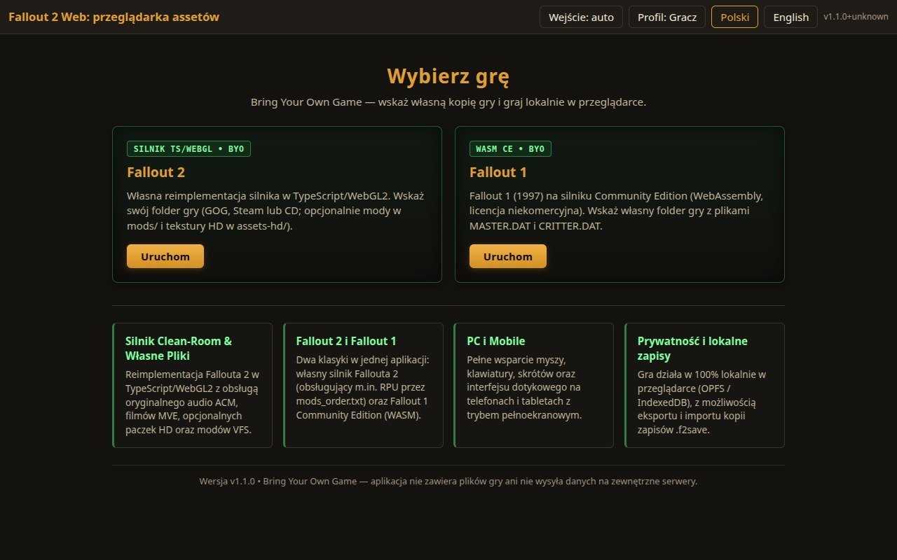
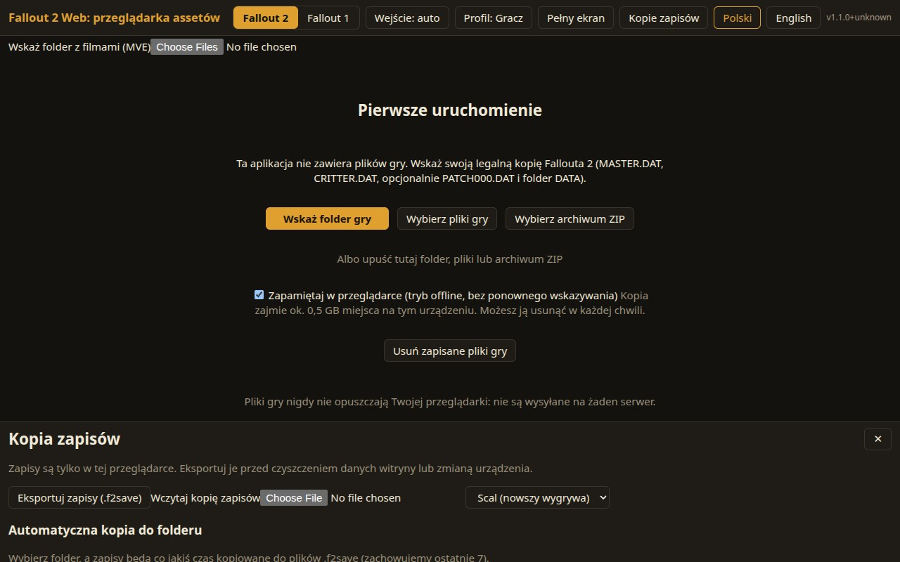
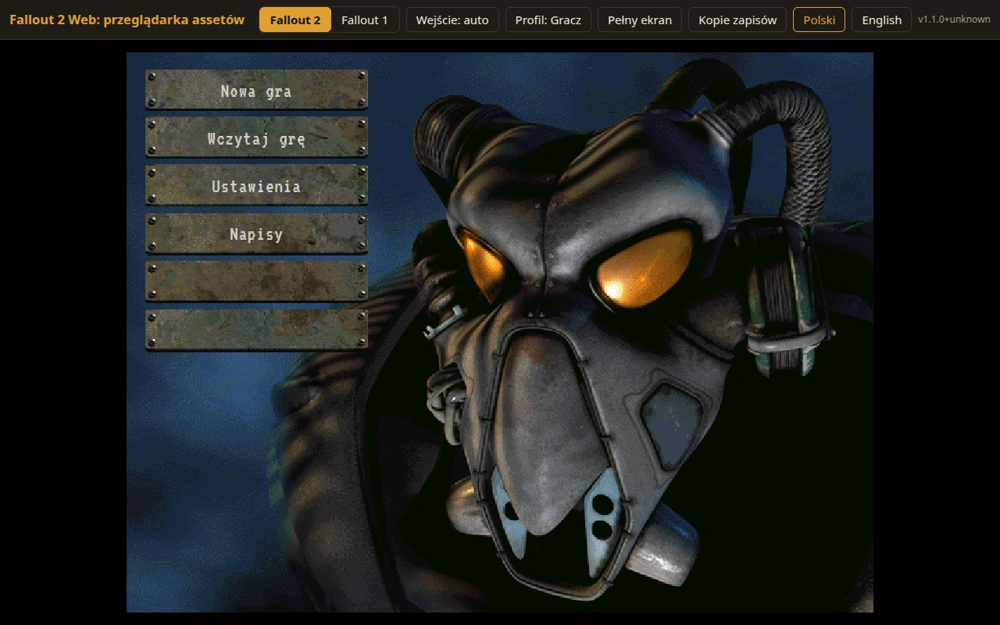
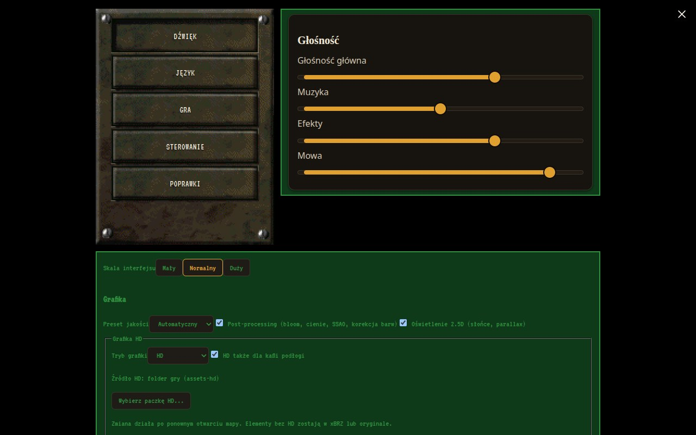
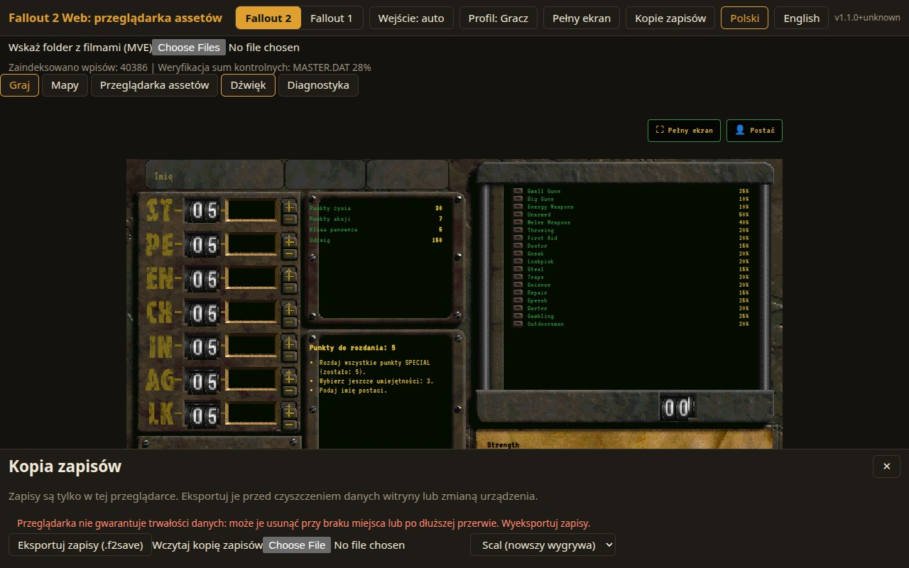
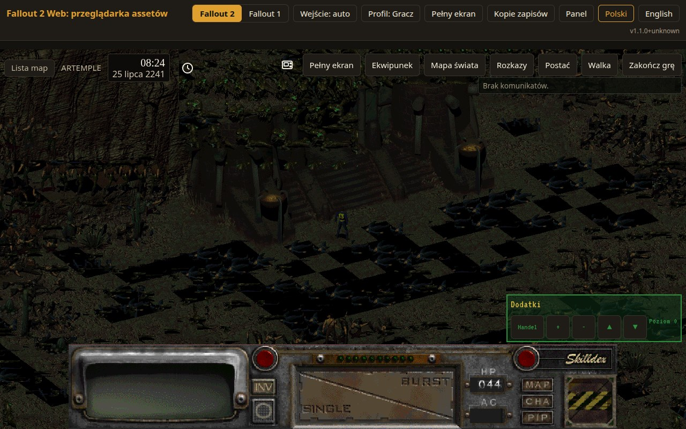
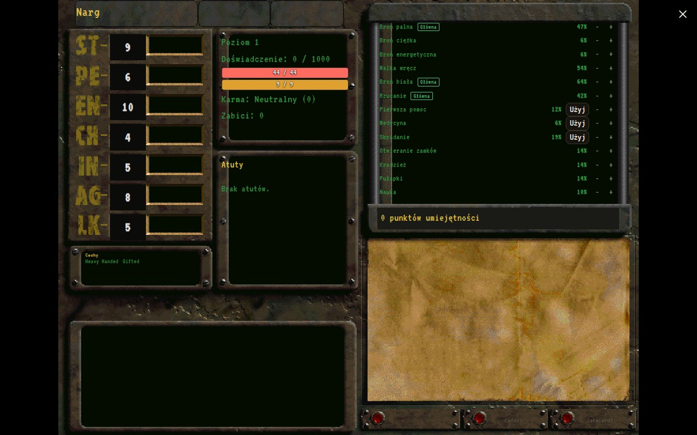
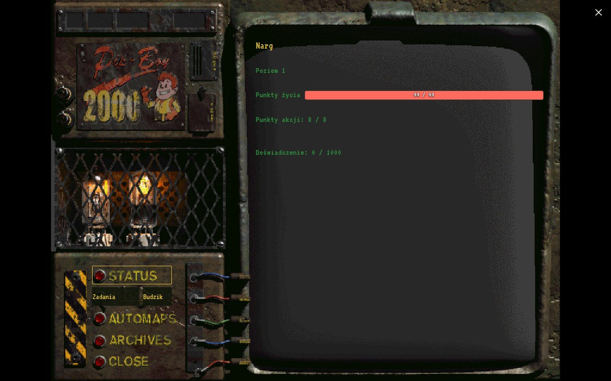
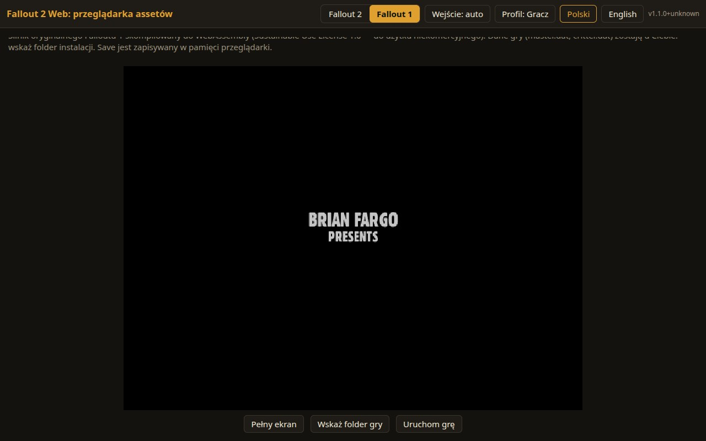

# Fallout 2 & Fallout 1 Web — Bring Your Own Game (v1.1.0)

**[Polski](README.md)** | **[English](README.en.md)**

Przeglądarkowa edycja **Fallouta 2** (własny silnik **TypeScript + WebGL2**) oraz **Fallouta 1** (osadzony silnik **Community Edition** skompilowany do **WebAssembly**), działająca w 100% lokalnie w modelu **Bring Your Own Game (BYO)**.

Aplikacja **nie zawiera żadnych oryginalnych plików gier** (grafik, dźwięków, filmów, skryptów ani tekstów). Aby zagrać, wskazujesz na własnym urządzeniu folder, pliki lub archiwum `.zip` ze swoją legalną kopią gry (np. z GOG, Steam lub płyty CD). Wszystkie dane przetwarzane są wyłącznie lokalnie w pamięci przeglądarki (OPFS / IndexedDB) i nigdy nie są nigdzie wysyłane.

---

## Spis treści

1. [Zrzuty ekranu (Screenshots)](#zrzuty-ekranu-screenshots)
2. [Kwestie prawne i licencje](#kwestie-prawne-i-licencje)
3. [Wymagania](#wymagania)
4. [Szczegółowa instrukcja uruchomienia (lokalnie)](#szczegółowa-instrukcja-uruchomienia-lokalnie)
5. [Hosting statyczny (Nginx, Caddy, Cloudflare / Netlify / GitHub Pages)](#hosting-statyczny-produkcja)
6. [Jak wczytać własną grę (Fallout 2 i Fallout 1)](#jak-wczytać-własną-grę-fallout-2-i-fallout-1)
7. [Tekstury HD (`hd-pack/assets-hd/`) i efekty 2.5D](#tekstury-hd-hd-packassets-hd-i-efekty-25d)
8. [Mody (Fallout 2 VFS)](#mody-fallout-2-vfs)
9. [Sterowanie (PC oraz telefon/tablet)](#sterowanie-pc-oraz-telefontablet)
10. [Profile, zapisy gry i kopie zapasowe](#profile-zapisy-gry-i-kopie-zapasowe)
11. [Bezpieczeństwo, CSP i prywatność](#bezpieczeństwo-csp-i-prywatność)
12. [Rozwiązywanie problemów i dokumentacja](#rozwiązywanie-problemów-i-dokumentacja)

---

## Zrzuty ekranu (Screenshots)

### Ekran główny — wybór gry (Fallout 2 / Fallout 1)


### Fallout 2 — wczytanie własnej kopii gry (BYO)


### Fallout 2 — menu główne i opcje grafiki HD / 2.5D
| Menu główne | Opcje (HD, oświetlenie 2.5D, poprawki) |
|---|---|
|  |  |

### Fallout 2 — kreator postaci i rozgrywka na mapie (HD + 2.5D)
| Kreator postaci | Mapa gry (HD + oświetlenie 2.5D) |
|---|---|
|  |  |

### Fallout 2 — karta postaci, ekwipunek i Pip-Boy 2000
| Karta postaci | Ekwipunek | Pip-Boy 2000 |
|---|---|---|
|  |  |  |

### Fallout 1 — Community Edition (WebAssembly)


---

## Kwestie prawne i licencje

- **Kod aplikacji i silnika Fallout 2 (TypeScript/WebGL2):** licencja **[MIT](LICENSE)**.
- **Brak plików gier w aplikacji i buildzie:** pliki `.dat`, `.frm`, `.acm`, `.mve`, `.pro`, `.map`, `.int`, `.msg`, `.exe` są blokowane przez `.gitignore` oraz strażnika [`scripts/guard-no-game-files.mjs`](scripts/guard-no-game-files.mjs). Paczka wynikowa `apps/web/dist/` nie zawiera żadnych zasobów gier ani paczki HD.
- **Opcjonalna paczka HD (`hd-pack/assets-hd/`):** umieszczona osobno obok aplikacji jako dodatek wizualny do użycia wyłącznie z własną, legalną kopią Fallouta 2 (nie jest częścią kodu na licencji MIT ani builda `apps/web/dist/`).
- **Fallout 1 Community Edition (WASM):** katalogi `apps/web/public/engines/fo1-ce/` oraz `tools/fo1-ce-patches/` zawierają port Emscripten oparty na `alexbatalov/fallout1-ce` i `K1ngst0m/fallout1-ce-web` na licencji **[Sustainable Use License 1.0](licenses/SUSTAINABLE-USE-LICENSE-1.0.txt)** — **wyłącznie do użytku osobistego i niekomercyjnego** (szczegóły w [THIRD_PARTY_NOTICES.md](THIRD_PARTY_NOTICES.md)).
- **Font VT323:** licencja **SIL Open Font License 1.1**.
- **Znaki towarowe:** *Fallout* i *Fallout 2* są znakami towarowymi Bethesda Softworks LLC / ZeniMax Media Inc. Projekt jest niezależną implementacją hobbystyczną.

---

## Wymagania

### Przeglądarka (uruchomienie gry)
Nowoczesna przeglądarka z obsługą **WebGL2** i **WebAssembly**:
- **Chrome / Edge (Desktop i Android):** pełna obsługa bezpośredniego dostępu do folderu (File System Access API) oraz trwałego zapisu w OPFS.
- **Safari / iOS (15.4+, zalecane 16.4+):** wybór folderu przez `webkitdirectory` lub archiwum `.zip`; kopia zapisywana jest w OPFS (wymaga ok. 0,6–2 GB wolnego miejsca zależnie od modów).
- **Firefox:** wybór folderu / plików / `.zip` oraz zapis w OPFS.

### Środowisko developerskie (zbudowanie ze źródeł)
- **Node.js `>= 24`**
- **pnpm `12.x`** (`corepack enable` lub `npm i -g pnpm@12`)

---

## Szczegółowa instrukcja uruchomienia (lokalnie)

1. **Sklonuj repozytorium i zainstaluj zależności:**
   ```sh
   git clone https://github.com/cenkierpiotr/fallout2-web-byo.git
   cd fallout2-web-byo
   pnpm install
   ```

2. **Uruchom serwer deweloperski:**
   ```sh
   pnpm dev
   ```
   Otwórz w przeglądarce adres `http://localhost:5173`.

3. **Testowanie na telefonie w sieci lokalnej (opcjonalnie):**
   ```sh
   pnpm dev -- --host
   ```
   > **Uwaga:** poza `http://localhost` przeglądarki blokują OPFS, File System Access API i Service Workery na zwykłym HTTP — do testów na telefonie użyj lokalnego proxy HTTPS (np. Caddy / mkcert) albo hostingu z TLS.

4. **Weryfikacja i budowanie wersji produkcyjnej:**
   ```sh
   pnpm check                                              # eslint + tsc + vitest
   pnpm tools docs-check                                   # spójność dokumentacji
   pnpm --filter @f2/web build                             # paczka SPA/PWA -> apps/web/dist/
   node scripts/guard-no-game-files.mjs --dist apps/web/dist # weryfikacja braku plików gier w dist/
   pnpm --filter @f2/web preview                           # lokalny podgląd wersji produkcyjnej
   ```

---

## Hosting statyczny (Produkcja)

Aplikacja jest w 100% statycznym SPA + PWA (`apps/web/dist/`). Nie wymaga backendu ani bazy danych po stronie serwera.

### Wymagania obowiązkowe hostingu
1. **HTTPS** (wymagane przez OPFS, File System Access API i PWA).
2. **Nagłówki COOP / COEP** dla wielowątkowego WASM (`SharedArrayBuffer`) w Falloucie 1:
   - `Cross-Origin-Opener-Policy: same-origin`
   - `Cross-Origin-Embedder-Policy: require-corp`
3. **Reguły cache:** `no-cache` / `no-store` dla `index.html`, `sw.js`, `version.json` i `manifest.webmanifest`; `public, max-age=31536000, immutable` dla `/assets/*`.
4. **Typ MIME dla `.wasm`:** `application/wasm`.

### Przykład: Nginx (zob. też [`deploy/nginx.conf`](deploy/nginx.conf))
```nginx
server {
    listen 443 ssl http2;
    server_name twoja-domena.example;

    ssl_certificate     /etc/letsencrypt/live/twoja-domena.example/fullchain.pem;
    ssl_certificate_key /etc/letsencrypt/live/twoja-domena.example/privkey.pem;

    server_tokens off;
    root /var/www/fallout2-web-byo/dist;
    index index.html;

    add_header Cross-Origin-Opener-Policy "same-origin" always;
    add_header Cross-Origin-Embedder-Policy "require-corp" always;
    add_header X-Content-Type-Options "nosniff" always;
    add_header X-Frame-Options "DENY" always;
    add_header Referrer-Policy "no-referrer" always;

    location = /index.html           { add_header Cache-Control "no-cache" always; }
    location = /sw.js                { add_header Cache-Control "no-cache" always; }
    location = /version.json         { add_header Cache-Control "no-store" always; }
    location = /manifest.webmanifest { add_header Cache-Control "no-cache" always; }

    location /assets/ {
        add_header Cache-Control "public, max-age=31536000, immutable" always;
        try_files $uri =404;
    }

    location / {
        try_files $uri $uri/ /index.html;
        add_header Cache-Control "no-cache" always;
    }
}
```

### Inne platformy (Caddy / Cloudflare Pages / Netlify / GitHub Pages)
Pełny przykład dla **Caddy** (automatyczny HTTPS) oraz uwagi dla **Cloudflare Pages**, **Netlify** i **GitHub Pages** znajdziesz w **[`docs/SETUP.md`](docs/SETUP.md)**.

---

## Jak wczytać własną grę (Fallout 2 i Fallout 1)

Po otwarciu aplikacji wybierasz grę (**Fallout 2** albo **Fallout 1**). Wybór możesz przełączyć w każdej chwili w górnym pasku.

### Fallout 2
Przygotuj folder ze swoją legalną kopią gry (GOG, Steam, CD):
- **`MASTER.DAT`** i **`CRITTER.DAT`** (wymagane)
- **`PATCH000.DAT`** (zalecane — oficjalny patch 1.02)
- opcjonalnie **`DATA/`**, **`mods/`** oraz **`assets-hd/`**

Na ekranie **Pierwsze uruchomienie** wybierz jedną z metod:
1. **Wskaż folder gry** — główny katalog instalacji Fallouta 2.
2. **Wybierz pliki gry** — wskazanie plików ręcznie.
3. **Wybierz archiwum ZIP** — spakowany folder gry (import można wznowić po przerwaniu).
4. **Przeciągnij i upuść** folder, pliki lub `.zip` bezpośrednio w okno przeglądarki.

Zaznaczenie opcji **„Zapamiętaj w przeglądarce”** zapisuje kopię plików w lokalnym **OPFS**, dzięki czemu kolejne uruchomienia działają natychmiast i offline.

### Fallout 1 (Community Edition WASM)
1. Wybierz kartę **Fallout 1**.
2. Poczekaj na załadowanie silnika WebAssembly (`fallout-ce.wasm`).
3. Kliknij **Wskaż folder gry** i wybierz folder ze swoją instalacją Fallouta 1 zawierającą **`MASTER.DAT`** i **`CRITTER.DAT`** (oraz opcjonalnie nadpisania w `DATA/`).
4. Po zakończeniu importu kliknij **Uruchom grę**. Zapisy gry przechowywane są lokalnie w przeglądarce (IndexedDB / IDBFS).

---

## Tekstury HD (`hd-pack/assets-hd/`) i efekty 2.5D

Gotowa, opcjonalna paczka tekstur HD znajduje się obok silnika w katalogu **[`hd-pack/assets-hd/`](hd-pack/assets-hd/)** (ok. 295 MB: `manifest.json`, atlasy `base/` w xBRZ oraz atlasy `hd/`). Szczegóły w [`hd-pack/README.md`](hd-pack/README.md).

### Jak wgrać tekstury HD (2 sposoby)
1. **Automatycznie z folderem gry (zalecane):** skopiuj katalog `hd-pack/assets-hd/` do swojego folderu gry Fallout 2 (np. `Fallout 2/assets-hd/` albo `Fallout 2/DATA/assets-hd/`) przed wskazaniem folderu w aplikacji.
2. **Ręcznie po wczytaniu gry:** otwórz **Ustawienia (Opcje) → Grafika → Grafika HD → Wybierz paczkę HD...** i wskaż katalog `hd-pack/assets-hd/`, a następnie otwórz ponownie mapę lub zacznij nową grę.

Domyślnie aktywne są: tryb **HD**, **kafelki HD**, **oświetlenie 2.5D** i **post-processing (`postFx`)**. W **Opcjach** możesz w każdej chwili przełączać tryb obrazu (`Oryginał` / `Baza (xBRZ)` / `HD`) oraz poszczególne efekty. Bez paczki `assets-hd/` gra działa płynnie na oryginalnej grafice z plików gry.

---

## Mody (Fallout 2 VFS)

Silnik obsługuje warstwowe nadpisywanie zasobów (VFS) ponad `MASTER.DAT` / `CRITTER.DAT` / `PATCH000.DAT`:
- Umieść paczki `.dat` modów w podkatalogu **`mods/`** w folderze gry oraz opcjonalny plik kolejności **`mods/mods_order.txt`** (zgodny ze strukturą sfall / Restoration Project Updated, np. `rpu.dat`, `npc_armor.dat`, `rpu_polish.dat`, `cassidy_head.dat`, `party_orders.dat`).
- Wpisy na końcu `mods_order.txt` mają najwyższy priorytet; brakujące pliki są bezpiecznie pomijane.
- W **Opcjach → Poprawki** możesz przełączać wbudowane poprawki mechaniki oraz włączyć **Tryb klasyczny**.
- **Ograniczenie:** mody oparte na natywnych bibliotekach DLL sfall (np. `fo2tweaks`, `InventoryFilter`) nie są w pełni wspierane przez silnik przeglądarkowy — działa podzbiór zgodny ze skryptami `.int` i zasobami `.dat`.

---

## Sterowanie (PC oraz telefon/tablet)

- **Mysz:** LPM — ruch / interakcja / atak; PPM — menu radialne akcji (Rozmawiaj, Patrz, Idź, Biegnij, Anuluj); kółko — zoom; środkowy przycisk — przesuwanie kamery.
- **Klawiatura:** `W`/`A`/`S`/`D` lub strzałki — kamera; `+`/`=` i `-` — zoom; `0` — reset zoomu; `PageUp`/`PageDown` — piętro; `R` / `Shift` — bieg; `I` — ekwipunek; `F5` — szybki zapis; `Esc` — menu/pauza.
- **Dotyk (mobile/tablet):** tap — ruch lub akcja; długie przytrzymanie (350 ms) — menu radialne; podwójny tap — Patrz; przeciągnięcie jednym palcem — kamera; szczypanie (pinch) — zoom; podwójny tap dwoma palcami — reset zoomu; tap trzema palcami — pauza.
- Tryb sterowania (`Auto` / `Pulpit` / `Dotyk`) oraz **Pełny ekran** możesz przełączać na górnym pasku aplikacji.

---

## Profile, zapisy gry i kopie zapasowe

- **Lokalne profile graczy:** osobne sloty zapisów i ustawień w IndexedDB (opcjonalny PIN to wyłącznie lokalna blokada UI).
- **Autozapis:** co 5 minut (3 rotacyjne sloty) oraz przy przejściu między mapami.
- **Przenoszenie między urządzeniami (PC ↔ telefon):** przycisk **Kopia zapisów** na górnym pasku pozwala wyeksportować zapisy do **`.f2save`** (JSON + gzip) lub cały profil do **`.f2profile`**. Import wspiera tryby **Scal (`merge`)** (wygrywa nowszy zapis) oraz **Zastąp (`replace`)**.
- **Ważne dla iOS / Safari:** Safari potrafi usunąć dane witryny po ok. 7 dniach braku aktywności lub w trybie prywatnym — eksportuj regularnie plik `.f2save`.

---

## Bezpieczeństwo, CSP i prywatność

- **Zero wysyłania danych do sieci:** pliki gry, zapisy, profile i diagnostyka nie opuszczają przeglądarki.
- **Zalecane CSP (Content Security Policy):**
  ```text
  default-src 'self'; script-src 'self' 'wasm-unsafe-eval'; style-src 'self' 'unsafe-inline'; img-src 'self' blob: data:; media-src 'self' blob:; connect-src 'self' blob:; worker-src 'self' blob:; font-src 'self' data:; object-src 'none'; base-uri 'self'; frame-ancestors 'none';
  ```
  `'wasm-unsafe-eval'` jest wymagane wyłącznie dla WebAssembly (`fallout-ce.wasm`), a `blob:` dla lokalnych dekoderów grafiki i audio.
- **Diagnostyka lokalna:** bufor maks. 10 000 zdarzeń / 5 MB w IndexedDB dostępny w zakładce **Diagnostyka** (tylko ręczny eksport `.jsonl` lub wyczyszczenie).

---

## Rozwiązywanie problemów i dokumentacja

- **Czarny ekran:** włącz WebGL2 i akcelerację sprzętową w przeglądarce.
- **Brak dźwięku na iOS:** dotknij ekranu po uruchomieniu (wymagany gest użytkownika).
- **Spadek wydajności:** wyłącz `postFx` / oświetlenie 2.5D lub zmniejsz skalę interfejsu w Opcjach.
- **Dodatkowe dokumenty:**
  - [Pełna instrukcja uruchomienia, hostingu, bezpieczeństwa i legalności (`docs/SETUP.md`)](docs/SETUP.md)
  - [Instrukcja użycia paczki HD (`hd-pack/README.md`)](hd-pack/README.md)
  - [Instrukcja użytkownika PL (`docs/user/README.pl.md`)](docs/user/README.pl.md) | [User Guide EN (`docs/user/README.en.md`)](docs/user/README.en.md)
  - [Licencje podmiotów trzecich (`THIRD_PARTY_NOTICES.md`)](THIRD_PARTY_NOTICES.md) | [Historia zmian (`CHANGELOG.md`)](CHANGELOG.md)
