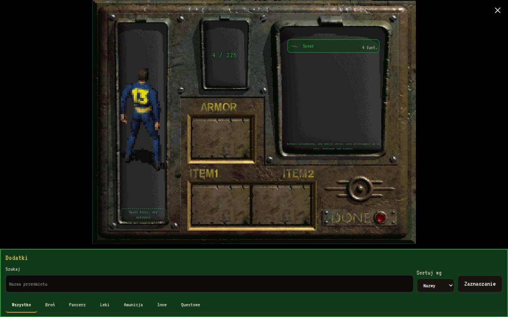

# Fallout 2 & Fallout 1 Web — Bring Your Own Game (v1.1.0)

> **English summary:** Open-source, **Bring-Your-Own-Game (BYO)** browser edition featuring a custom TypeScript/WebGL2 reimplementation of **Fallout 2** alongside **Fallout 1 Community Edition** (WebAssembly). **No copyrighted game files are included** — you supply your own legal game folder (GOG, Steam, CD) locally in your browser. Nothing is ever uploaded. See the [English User Guide](docs/user/README.en.md) and [THIRD_PARTY_NOTICES.md](THIRD_PARTY_NOTICES.md).

Przeglądarkowa wersja **Fallouta 2** (własny silnik TypeScript + WebGL2) oraz **Fallouta 1** (osadzony silnik Community Edition skompilowany do WebAssembly) działająca w 100% w modelu **Bring Your Own Game (BYO)**.

Aplikacja **nie zawiera żadnych oryginalnych zasobów gier** (grafik, dźwięków, filmów, skryptów ani tekstów). Aby zagrać, wskazujesz na własnym urządzeniu folder lub archiwum ZIP ze swoją legalną kopią gry (np. z GOG, Steam lub płyty CD). Wszystkie pliki przetwarzane są wyłącznie lokalnie w pamięci przeglądarki.

---

## Spis treści

1. [Zrzuty ekranu (Screenshots)](#zrzuty-ekranu-screenshots)
2. [Kwestie prawne i licencje](#kwestie-prawne-i-licencje)
3. [Wymagania](#wymagania)
4. [Szybki start (uruchomienie aplikacji)](#szybki-start-uruchomienie-aplikacji)
5. [Jak wczytać własną grę (Fallout 2 i Fallout 1)](#jak-wczytać-własną-grę-fallout-2-i-fallout-1)
6. [Mody i tekstury HD](#mody-i-tekstury-hd)
7. [Sterowanie (PC oraz telefon/tablet)](#sterowanie-pc-oraz-telefontablet)
8. [Profile, zapisy gry i kopie zapasowe](#profile-zapisy-gry-i-kopie-zapasowe)
9. [Samodzielny hosting statyczny i bezpieczeństwo](#samodzielny-hosting-statyczny-i-bezpieczeństwo)
10. [Rozwiązywanie problemów i prywatność](#rozwiązywanie-problemów-i-prywatność)

Więcej szczegółów znajdziesz w pełnej instrukcji:
- [Szczegółowa instrukcja uruchomienia, hostingu, bezpieczeństwa i legalności (`docs/SETUP.md`)](docs/SETUP.md)
- [Instrukcja użytkownika (PL)](docs/user/README.pl.md) | [User Guide (EN)](docs/user/README.en.md)

---

## Zrzuty ekranu (Screenshots)

### Ekran główny — wybór gry (Fallout 2 / Fallout 1)


### Fallout 2 — wczytanie własnej kopii gry (BYO)


### Fallout 2 — menu główne i opcje grafiki HD / 2.5D
| Menu główne | Opcje (HD, oświetlenie 2.5D, poprawki) |
|---|---|
|  |  |

### Fallout 2 — kreator postaci i rozgrywka na mapie (HD + 2.5D)
| Kreator postaci | Mapa gry (HD + oświetlenie 2.5D) |
|---|---|
|  |  |

### Fallout 2 — karta postaci, ekwipunek i Pip-Boy 2000
| Karta postaci | Ekwipunek | Pip-Boy 2000 |
|---|---|---|
|  |  |  |

### Fallout 1 — Community Edition (WebAssembly)


---

## Kwestie prawne i licencje

- **Kod aplikacji i silnika Fallout 2 (TypeScript/WebGL2):** udostępniony na licencji [MIT](LICENSE).
- **Brak plików gier w repozytorium:** pliki `.dat`, `.frm`, `.acm`, `.mve`, `.pro`, `.map`, `.int`, `.msg`, `.exe` są blokowane przez `.gitignore` oraz strażnika `scripts/guard-no-game-files.mjs`.
- **Fallout 1 Community Edition (WASM):** katalogi `apps/web/public/engines/fo1-ce/` oraz `tools/fo1-ce-patches/` zawierają port Emscripten oparty na `alexbatalov/fallout1-ce` i `K1ngst0m/fallout1-ce-web` na licencji **Sustainable Use License 1.0** — **wyłącznie do użytku osobistego / niekomercyjnego** (szczegóły w [THIRD_PARTY_NOTICES.md](THIRD_PARTY_NOTICES.md) oraz [licenses/SUSTAINABLE-USE-LICENSE-1.0.txt](licenses/SUSTAINABLE-USE-LICENSE-1.0.txt)).
- **Znaki towarowe:** *Fallout* i *Fallout 2* są znakami towarowymi Bethesda Softworks LLC / ZeniMax Media Inc. Projekt jest niezależną implementacją hobbystyczną.

---

## Wymagania

- **Do uruchomienia w przeglądarce:** nowoczesna przeglądarka z obsługą **WebGL2** i **WebAssembly**:
  - **Chrome / Edge (Desktop & Android):** pełna obsługa bezpośredniego dostępu do folderu (File System Access API) oraz pamięci OPFS.
  - **Safari / iOS (15.4+, zalecane 16.4+):** wybór folderu przez `webkitdirectory` lub archiwum `.zip`, kopia zapisywana w OPFS (wymaga ok. 0,6–2 GB wolnego miejsca zależnie od modów).
  - **Firefox:** wybór folderu / plików / `.zip` oraz zapis w OPFS.
- **Do zbudowania ze źródeł:** `Node.js >= 24` oraz `pnpm` (`12.x`).

---

## Szybki start (uruchomienie aplikacji)

1. Sklonuj repozytorium i zainstaluj zależności:
   ```sh
   pnpm install
   pnpm dev
   ```
2. Otwórz wyświetlony adres (domyślnie `http://localhost:5173`) w przeglądarce.
   - Aby przetestować na telefonie w tej samej sieci Wi-Fi, uruchom z `--host` (`pnpm dev -- --host`), pamiętając, że funkcje OPFS / PWA / File System Access wymagają poza `localhost` połączenia **HTTPS** (np. lokalny proxy HTTPS lub własna domena z certyfikatem).

Pozostałe przydatne komendy developerskie:
- `pnpm check` — lint, sprawdzanie typów TypeScript oraz testy jednostkowe (`vitest`)
- `pnpm --filter @f2/web build` — budowanie statycznej paczki produkcyjnej do `apps/web/dist`

---

## Jak wczytać własną grę (Fallout 2 i Fallout 1)

Po otwarciu aplikacji zobaczysz ekran wyboru gry (**Fallout 2** albo **Fallout 1**). Wybór zostaje zapamiętany (możesz go zmienić później w górnym pasku).

### Fallout 2

Przygotuj folder ze swoją kopią gry (GOG, Steam, CD). Minimalnie potrzebne są:
- **`MASTER.DAT`** i **`CRITTER.DAT`** (wymagane)
- **`PATCH000.DAT`** (zalecane — oficjalny patch 1.02)
- opcjonalnie folder **`DATA/`**, **`mods/`** oraz **`assets-hd/`** (jeśli używasz modów lub tekstur HD)

Na ekranie pierwszego uruchomienia wybierz jedną z metod:
1. **Wskaż folder gry** — wybierz główny katalog instalacji Fallouta 2.
2. **Wybierz pliki gry** — wskaż pliki ręcznie.
3. **Wybierz archiwum ZIP** — spakowany folder gry (import można wznowić po przerwaniu).
4. **Przeciągnij i upuść** folder, pliki lub plik `.zip` bezpośrednio w okno przeglądarki.

Zaznaczenie opcji **„Zapamiętaj w przeglądarce”** zapisuje kopię plików w lokalnej pamięci przeglądarki (OPFS), dzięki czemu kolejne uruchomienia działają natychmiast i w trybie offline. Dane gry **nie są nigdzie wysyłane**.

### Fallout 1 (Community Edition WASM)

1. Wybierz kartę **Fallout 1**.
2. Poczekaj na załadowanie silnika WebAssembly (`fallout-ce.wasm`).
3. Kliknij **Wskaż folder gry** i wybierz folder ze swoją instalacją Fallouta 1 zawierającą pliki **`MASTER.DAT`** i **`CRITTER.DAT`** (oraz opcjonalnie nadpisania w `DATA/`).
4. Po zakończeniu importu kliknij **Uruchom grę**. Postępy zapisywane są lokalnie w pamięci przeglądarki (IndexedDB / IDBFS).

---

## Mody i tekstury HD

### Mody w Fallout 2
Silnik obsługuje warstwowe nadpisywanie zasobów (VFS) ponad `MASTER.DAT` / `CRITTER.DAT` / `PATCH000.DAT`:
- Rozpakuj lub wgraj paczki `.dat` do podkatalogu **`mods/`** w folderze gry oraz opcjonalny plik kolejności **`mods/mods_order.txt`** (zgodny ze strukturą sfall / Restoration Project Updated, np. `rpu.dat`, `npc_armor.dat`, `rpu_polish.dat`, `cassidy_head.dat`, `party_orders.dat`).
- Wpisy na końcu pliku `mods_order.txt` mają najwyższy priorytet; brakujące pliki są bezpiecznie pomijane.
- Dodatkowo silnik wbudowuje zestaw opcjonalnych poprawek mechaniki/proto — możesz je przełączać w **Opcjach** (w tym włączyć **Tryb klasyczny**, aby grać bez żadnych poprawek silnika).

> **Uwaga:** mody oparte wyłącznie na natywnych skryptach binarnych DLL sfall (np. `fo2tweaks`, `InventoryFilter`) nie są w pełni wspierane przez silnik przeglądarkowy — działa podzbiór zgodny ze skryptami `.int` i zasobami `.dat`.

### Grafika HD i efekty 2.5D
- Domyślnie aktywny jest tryb **HD**, **kafelki HD**, **oświetlenie 2.5D** i **post-processing (postFx)**.
- Jeśli w folderze gry (lub obok) znajduje się katalog **`assets-hd/`** z zatwierdzonym manifestem atlasów, silnik automatycznie użyje tekstur HD.
- Bez paczki `assets-hd/` gra płynnie działa na oryginalnej grafice z plików gry; tryb obrazu możesz zmienić w każdej chwili w **Opcjach** (`Oryginał` / `Baza` / `HD`).

---

## Sterowanie (PC oraz telefon/tablet)

- **Mysz:** LPM — ruch / interakcja / atak; PPM — menu radialne akcji (Rozmawiaj, Patrz, Idź, Biegnij, Anuluj); kółko — przybliżenie/oddalenie; środkowy przycisk — przesuwanie kamery.
- **Klawiatura:** `W`/`A`/`S`/`D` lub strzałki — kamera; `+` / `-` — zoom; `0` — reset zoomu; `PageUp`/`PageDown` — piętro; `R` / `Shift` — bieg; `I` — ekwipunek; `F5` — szybki zapis; `Esc` — menu/pauza.
- **Dotyk (mobile/tablet):** tap — ruch lub akcja; długie przytrzymanie (350 ms) — menu radialne; podwójny tap — Patrz; przeciągnięcie jednym palcem — kamera; szczypanie (pinch) — zoom; podwójny tap dwoma palcami — reset zoomu; tap trzema palcami — pauza.
- Tryb sterowania (`Auto` / `Pulpit` / `Dotyk`) oraz **Pełny ekran** możesz przełączać na górnym pasku aplikacji.

---

## Profile, zapisy gry i kopie zapasowe

- **Lokalne profile graczy:** osobne sloty zapisów i ustawień w IndexedDB (opcjonalny PIN to wyłącznie lokalna blokada UI).
- **Autozapis:** automatyczny zapis co 5 minut (3 rotacyjne sloty) oraz przy przejściu między mapami.
- **Przenoszenie między urządzeniami (PC ↔ telefon):** użyj przycisku **Kopia** w górnym pasku, aby wyeksportować zapisy do pliku **`.f2save`** (JSON + gzip) lub cały profil do **`.f2profile`**. Podczas importu możesz wybrać scalenie (`merge` — wygrywa nowszy zapis) albo zastąpienie (`replace`).
- **Ważne dla iOS / Safari:** Safari potrafi usunąć dane witryny po ok. 7 dniach braku aktywności lub w trybie prywatnym. Eksportuj regularnie plik `.f2save`.

---

## Samodzielny hosting statyczny i bezpieczeństwo

Aplikacja jest w 100% statycznym SPA + PWA (brak backendu i bazy na serwerze):

```sh
pnpm --filter @f2/web build
node scripts/guard-no-game-files.mjs --dist apps/web/dist
```

Zawartość katalogu `apps/web/dist/` możesz wystawić na dowolnym serwerze WWW (np. korzystając z przykładowej konfiguracji w [`deploy/nginx.conf`](deploy/nginx.conf)). **Wymagany jest HTTPS** (lub `http://localhost`), ponieważ przeglądarki blokują OPFS, File System Access API oraz Service Workery na zwykłym HTTP.

Pełna konfiguracja **Nginx**, **Caddy**, nagłówków **COOP/COEP** (dla `SharedArrayBuffer` w Fallout 1 WASM), **CSP**, zasad bezpieczeństwa oraz wytycznych prawnych znajduje się w **[`docs/SETUP.md`](docs/SETUP.md)**.

---

## Rozwiązywanie problemów i prywatność

- **Czarny ekran:** upewnij się, że przeglądarka ma włączone WebGL2 i akcelerację sprzętową.
- **Brak dźwięku na iOS:** stuknij ekran po uruchomieniu — Safari wymaga gestu użytkownika przed odtworzeniem audio.
- **Spadek wydajności na starszym urządzeniu:** wyłącz efekty `postFx` / oświetlenie 2.5D lub zmniejsz skalę interfejsu w Opcjach.
- **Diagnostyka i prywatność:** aplikacja **nie wysyła żadnej telemetrii ani plików gry do sieci**. Lokalny bufor diagnostyczny (FPS, błędy VM) dostępny jest w zakładce **Diagnostyka**, gdzie możesz go ręcznie wyeksportować (`.jsonl`) lub wyczyścić.
